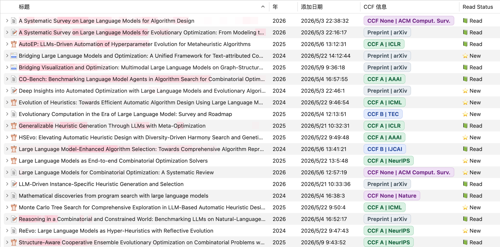
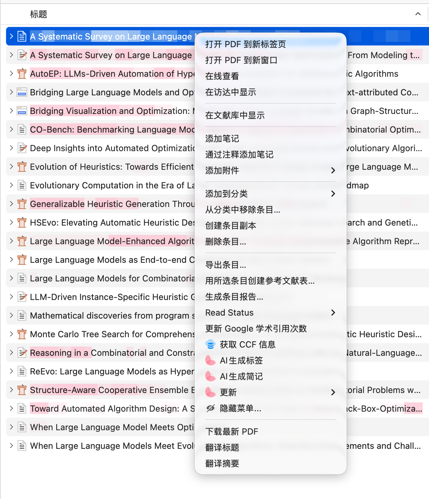

# Zotero CCF Plus 🚀

  
  
  

**Zotero CCF Plus** 是一款极简、高效的 Zotero 学术评级与文献引用量瞬时获取插件。它能够帮助您一键自动标注 **最新 2026 年第七版 CCF（中国计算机学会）推荐期刊与会议分级**，完善文献的出版物全称，并获取文献的最新引用次数，让您的学术文献管理与筛选变得无比轻松。

**Zotero CCF Plus** is a lightweight and highly efficient Zotero plugin that instantly fetches **the latest 2026 (7th Edition) CCF academic rankings**, journal/conference full names, and paper citation counts, making literature screening and organization effortless.

---

## ✨ 它能为您做什么？(What Can It Do?)

* ⚡ **自动标注最新 CCF 学术评级**：一键为文献匹配并标注 **CCF-A / B / C** 分级，**100% 完整支持最新的 2026 年第七版 CCF 推荐期刊与会议目录**（包括 arXiv 预印本、期刊与会议）。
* 🎨 **彩色标签直观呈现**：主列表中支持以 **绿色 (CCF A)**、**蓝色 (CCF B)**、**黄色 (CCF C)**、**紫色 (CCF None)** 和 **灰色 (Preprint)** 等精美的彩色标签直观分类呈现。
* 📖 **完善出版物会刊全称**：自动补全或校对文献对应的期刊/会议缩写与英文完整名称。
* 📈 **获取实时文献引用量**：智能查询文献在学术网络中的最新引用次数（Citations），并在主列表专用列直观显示，方便评估文献学术影响力。
* 📝 **结构化笔记归档**：匹配到的学术信息将自动同步创建一个结构化的富文本 `Note`（文献笔记）子条目进行本地永久归档。

---

## 📸 界面展示 (Screenshots & Demo)

  
   
  <i>文献主列表多维度 CCF 评级与 arXiv 预印本彩色标签直观呈现效果 (Direct rendering of CCF grades & arXiv preprint color labels in the main list)</i>

 

  
   
  <i>鼠标右键一键获取文献学术评级、出版物会刊全称与实时引用量演示 (One-click right-click to fetch CCF rankings and citations)</i>

---

## 📥 安装指南 (Installation)

1. 前往本仓库的 [Releases](https://github.com/Fangziyang0910/zotero-ccf-plus/releases) 页面，下载最新的 `.xpi` 格式插件包（例如 `zotero-ccf-plus.xpi` 或 `ccfplus@timetrapzz.site.xpi`）。
2. 打开 Zotero，在菜单栏点击 `Tools` (工具) -> `Add-ons` (附加组件)。
3. 点击右上角的齿轮图标，选择 `Install Add-on From File...` (从文件安装附加组件...)。
4. 选择下载的 `.xpi` 文件安装，重启 Zotero 即可。

For Zotero 10 installation and manual validation, see the
[Windows compatibility checklist](./doc/zotero10-testing.md).

---

## 🤝 致谢与声明 (Credits & Acknowledgement)

* 感谢项目 [windingwind/zotero-plugin-template](https://github.com/windingwind/zotero-plugin-template) 提供的插件模板骨架。
* 感谢原作者 [TimeTrapzz](https://github.com/TimeTrapzz) 与 [tojunfeng](https://github.com/tojunfeng) 奠定的插件核心开发与本地匹配算法基础。

---

## 📄 许可证 (License)

本项目采用 **AGPL-3.0-or-later** 许可证开源，请在遵守开源协议的前提下进行分发和二次开发。
